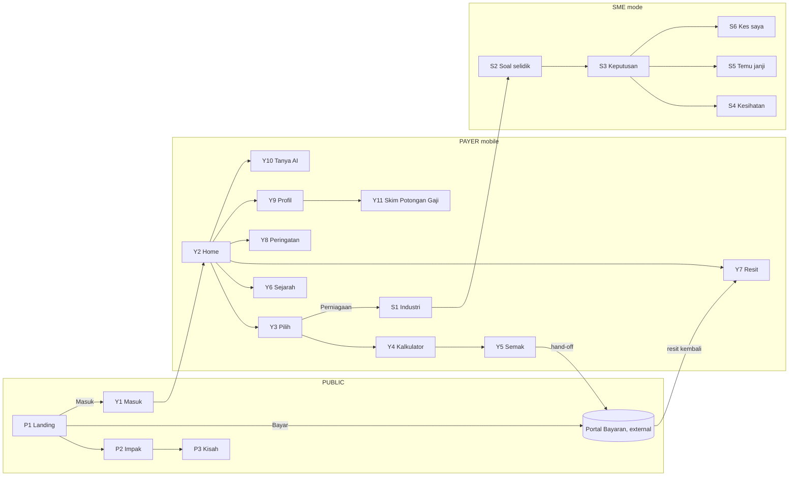
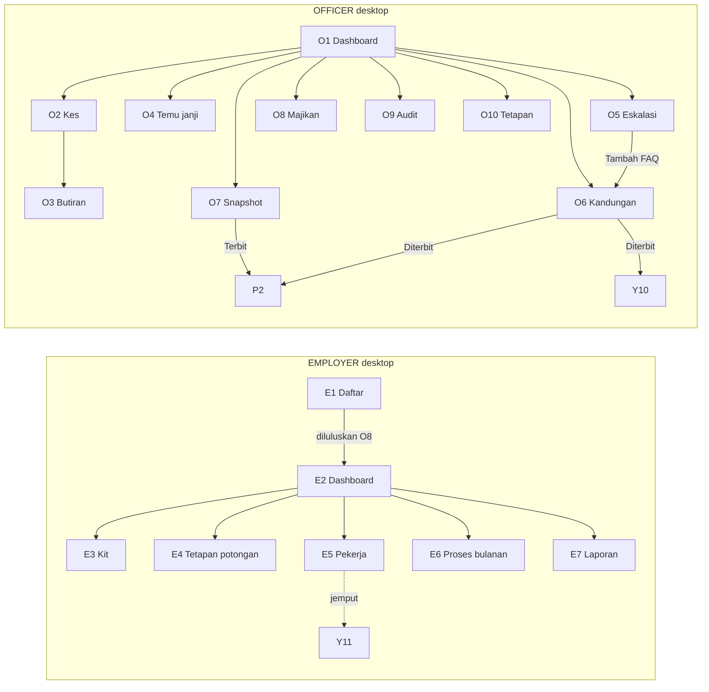
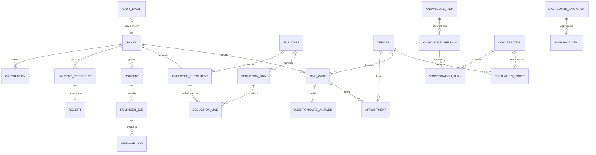

# ZakatTech 360 — Design Brief for Claude Design
## Every view as a wireframe, every rule as a constraint

*Prepared by Kiyo Software Tech Lab as technology provider. Read this file top to bottom before producing anything. Section 5 holds one ASCII wireframe per view with clarification notes; Claude Design turns those into the visual prototype. Sections 1–4 tell you what the system is and what it must never do. Sections 6–11 carry the data model, seed data, behaviour rules and the folder architecture the real build will follow after the prototype.*

---

## 1. Product summary

**ZakatTech 360** is a digital engagement and intelligence layer placed on top of the existing Pusat Zakat systems. It does not rebuild zakat infrastructure. It makes it easier for people and businesses to calculate, understand, pay, and keep paying zakat through official channels, and it shows the public where the money goes.

The existing foundation is strong: Skim Potongan Gaji salary deductions, Portal Bayaran Rasmi online payment, and a distribution record the public can be proud of. The strategic challenge has moved from channel availability to **conversion and retention**: turning eligible Muslims into confident, regular, official-channel payers. Four friction points sit in the payer journey: a trust gap, a knowledge gap, a convenience gap, and an engagement gap.

Five pillars answer them:

| # | Pillar | Answers |
|---|--------|---------|
| 1 | Digital Payer Experience | convenience gap, retention |
| 2 | Employer Connect | engagement gap (employers) |
| 3 | SME Zakat360 Advisory | knowledge gap (business zakat) |
| 4 | Trust and Impact Dashboard | trust gap |
| 5 | AI Zakat Assistant (governed) | knowledge gap, convenience gap |

Tagline, kept verbatim from the proposal: **Mudah Bayar, Jelas Manfaat.**

### 1.1 Non-negotiables

Every view in section 5 cites the numbers below. Claude Design must not produce a screen that breaks one of them.

| # | Rule | Source |
|---|------|--------|
| **#1** | Existing Pusat Zakat systems remain the authoritative systems. Payment always hands off to Portal Bayaran Rasmi. This platform is **not a new payment gateway** and never collects card details. | Brief: guardrails, "what this proposal is not" |
| **#2** | The AI assistant answers only from approved Pusat Zakat content. **No AI-generated religious rulings.** Every answer cites a published source. | Brief: AI Zakat Assistant, guardrails |
| **#3** | Complex, sensitive, or uncertain questions are **escalated to a human officer**. Authorized officers handle SME advisory and referrals. | Brief: guardrails, SME module |
| **#4** | Public reporting is **aggregated and privacy-safe**. The dashboard shows verified, published snapshots only, never live records. Stories are anonymised. | Brief: Trust and Impact Dashboard |
| **#5** | Every important calculation, payment status, deduction, content approval and escalation is **traceable** in an append-only audit trail. | Brief: guardrails |
| **#6** | **Consent before** reminders, WhatsApp messages, or payroll deductions. Consent is visible to the person and revocable. | Brief: guardrails |
| **#7** | All Shariah content (FAQs, calculator explanations, industry templates, stories, HR kit text) is **reviewed and approved before publication**. | Brief: guardrails |
| **#8** | Access to payroll, payment and dashboard data through APIs is **not yet confirmed**. Every Pusat Zakat touchpoint is designed stub-first and switchable to a real adapter. | Brief: guardrails, suggested architecture |

### 1.2 What success looks like

Increase in zakat harta collection and Skim Potongan Gaji participants; more digital and repeat payments; employers onboarded; SMEs using advisory tools; better payer trust scores; routine inquiries handled by the assistant; fewer abandoned payment journeys. The prototype does not measure these, but every surface below is shaped by them.

---

## 2. Surfaces, roles, device priority

| Surface | Vue app | Who | Device priority | Hosts |
|---------|---------|-----|-----------------|-------|
| **Public site + Trust and Impact Dashboard** | `web/apps/public` | public, asnaf community | desktop + mobile | P1–P3 |
| **Payer portal** | `web/apps/payer` | payer, sme_owner, Skim Potongan Gaji employee | **mobile-first PWA, 390×844 reference** | Y1–Y11, S1–S6 |
| **Employer portal** | `web/apps/employer` | employer_hr | desktop | E1–E7 |
| **Officer console** | `web/apps/officer` | officer, shariah_reviewer, admin | desktop | O1–O10 |
| **WhatsApp channel** | messaging adapter | payer | phone | mirrors Y10 and reminders from Y8 |

### 2.1 Roles

| Role | Can | Cannot |
|------|-----|--------|
| `public` | read P1–P3 | see any personal record |
| `payer` | Y1–Y11 | see other payers, see unpublished content |
| `sme_owner` | payer rights + S1–S6 | approve anything |
| `employer_hr` | E1–E7 for their own employer | see payer records outside their enrolment list |
| `officer` | O1–O5, O8, read O9 | approve Shariah content, publish snapshots |
| `shariah_reviewer` | O6, read O9 | handle cases, publish snapshots |
| `admin` | O7 publish, O10, all read | edit audit log (nobody can) |

### 2.2 Language

User-facing copy is **Bahasa Melayu** (the wireframes already use it). Code identifiers, routes, enum values and database names are English. Where a BM label is shown in a wireframe, treat it as the display string, not the identifier.

---

## 3. View inventory

| Id | Surface | View | Route | Role | Device | Primary action |
|----|---------|------|-------|------|--------|----------------|
| P1 | public | Landing | `/` | public | both | Kira zakat / Bayar di Portal Bayaran Rasmi |
| P2 | public | Trust and Impact Dashboard | `/impak` | public | both | filter period and district |
| P3 | public | Impact Story Detail | `/impak/kisah/:id` | public | both | read |
| Y1 | payer | Login / Daftar | `/masuk` | public | mobile | Hantar OTP |
| Y2 | payer | Home | `/` | payer | mobile | Bayar baki |
| Y3 | payer | Pilih Kalkulator | `/kira` | payer | mobile | pick a type |
| Y4 | payer | Kalkulator | `/kira/:jenis` | payer | mobile | Seterusnya |
| Y5 | payer | Semak dan Bayar | `/kira/semak` | payer | mobile | Bayar di Portal Bayaran Rasmi |
| Y6 | payer | Sejarah Bayaran | `/sejarah` | payer | mobile | filter |
| Y7 | payer | Peti Resit | `/resit` | payer | mobile | PDF / Kongsi |
| Y8 | payer | Peringatan dan Kebenaran | `/peringatan` | payer | mobile | save / revoke consent |
| Y9 | payer | Profil | `/profil` | payer | mobile | Urus Skim Potongan Gaji |
| Y10 | payer | Tanya AI | `/tanya` | payer | mobile | send / Hubungi pegawai |
| Y11 | payer | Daftar Skim Potongan Gaji | `/potongan-gaji` | payer | mobile | Hantar ke HR |
| S1 | payer (SME) | Pilih Industri | `/perniagaan` | sme_owner | mobile | pick industry |
| S2 | payer (SME) | Soal Selidik Berpandu | `/perniagaan/soal-selidik` | sme_owner | mobile | Terus |
| S3 | payer (SME) | Penjelasan Pengiraan | `/perniagaan/keputusan` | sme_owner | mobile | Tanya pegawai |
| S4 | payer (SME) | Semakan Kesihatan Perniagaan | `/perniagaan/kesihatan` | sme_owner | mobile | read |
| S5 | payer (SME) | Temu Janji Pegawai | `/perniagaan/temu-janji` | sme_owner | mobile | Tempah |
| S6 | payer (SME) | Kes Saya | `/perniagaan/kes` | sme_owner | mobile | open case |
| E1 | employer | Pendaftaran Majikan | `/daftar` | public → employer_hr | desktop | Seterusnya |
| E2 | employer | Dashboard Majikan | `/` | employer_hr | desktop | Jana fail potongan |
| E3 | employer | Kit Onboarding HR | `/kit` | employer_hr | desktop | download |
| E4 | employer | Tetapan Potongan Gaji | `/potongan/tetapan` | employer_hr | desktop | Simpan |
| E5 | employer | Pekerja dan Persetujuan | `/pekerja` | employer_hr | desktop | Jemput pekerja |
| E6 | employer | Proses Potongan Bulanan | `/potongan/:bulan` | employer_hr | desktop | Sahkan dan hantar |
| E7 | employer | Laporan | `/laporan` | employer_hr | desktop | Jana PDF |
| O1 | officer | Dashboard Pegawai | `/` | officer+ | desktop | open a queue |
| O2 | officer | Barisan Nasihat PKS | `/kes` | officer | desktop | Tugaskan |
| O3 | officer | Butiran Kes | `/kes/:id` | officer | desktop | Sahkan / Betulkan / Rujuk |
| O4 | officer | Kalendar Temu Janji | `/temu-janji` | officer | desktop | block / reschedule |
| O5 | officer | Peti Eskalasi AI | `/eskalasi` | officer | desktop | Jawab / Tambah FAQ |
| O6 | officer | Semakan Kandungan | `/kandungan` | shariah_reviewer, officer (draft only) | desktop | Lulus / Tolak / Terbit |
| O7 | officer | Penerbitan Snapshot Impak | `/impak` | admin (publish), officer (generate) | desktop | Terbit |
| O8 | officer | Kelulusan Majikan | `/majikan` | officer | desktop | Lulus / Minta dokumen |
| O9 | officer | Log Audit | `/audit` | all console roles | desktop | search |
| O10 | officer | Tetapan | `/tetapan` | admin | desktop | save |

### 3.1 Navigation





---

## 4. Visual design system

Proposed tokens. Hex values follow the green-and-white Islamic look set by Kiyo Software Tech Lab on Oct 9 2026; Claude Design may tune them but must keep the roles.

### 4.1 Tokens

| Token | Value | Use |
|-------|-------|-----|
| `--primary` | `#0B6B3A` deep emerald | headings, primary buttons, officer rail, active nav |
| `--primary-soft` | `#148A4D` leaf green | hover, secondary emphasis |
| `--primary-deep` | `#064B29` forest | hero gradient end, officer rail background, footer |
| `--accent` | `#1E8E5A` green | success, "Disahkan" and "Diterbit" badges, the tagline |
| `--accent-soft` | `#DFF3E8` mint | success backgrounds, KPI tiles |
| `--gold` | `#C9A227` | ornament lines, star-pattern strokes, active chip ring — never a status colour |
| `--gold-soft` | `#F6EEDC` sand | hero ornament fill, story illustration backdrop |
| `--warn` | `#D97A1A` | "Menunggu", attention counters |
| `--danger` | `#C8352B` | "Gagal", revoke consent, reject |
| `--surface` | `#FFFFFF` on `--bg #F3F8F5` | cards on page |
| `--glass` | `rgba(255,255,255,0.78)` + blur 12px | hero and KPI tiles only, never on tables |
| `--text` / `--muted` | `#10261B` / `#5A6E62` | body / helper text |
| `--pattern` | inline SVG data-URI, 8-point star tile, 1px gold at 18% | hero, officer rail, footers — never behind tables or forms |
| Radius | 12px cards, 8px inputs, 999px chips; pointed-arch top on hero and feature cards | |
| Spacing | 8-pt grid, 16px page gutter on mobile | |
| Type | Inter (or system sans) body, 16px mobile, 14px tables desktop; headings serif (Georgia or system serif), 600 weight | |

**Islamic style rules**: white surfaces dominate; green carries structure (headers, buttons, rail, active nav); gold is ornament only. Geometry comes from an 8-point star (khatam) tile drawn in CSS, a pointed-arch top edge on the hero and feature cards, and a thin gold rule with a diamond centre under section titles. Status colours stay exactly as the badge spec (ok green · menunggu amber · gagal red · Diterbit green outline · Draf grey). No images, no downloaded fonts.

### 4.2 Components to build once

Card, KPI tile (label, value, period line, optional trend), table with sticky header and 50-row pagination, drawer form (desktop), full-screen sheet form (mobile), stepper (`langkah n/N`), status badge (`ok` green, `menunggu` amber, `gagal` red, `Diterbit` green outline, `Draf` grey), source chip (assistant answers: `sumber: FAQ #12`), consent block (checkbox + dated line + revoke link), audit line (time, actor, entity, action, hash), empty state (icon, one sentence, one button), toast.

### 4.3 Shells

**Mobile shell (payer app)**: top bar with back arrow and title; content; bottom nav with five items: Utama · Kira · Resit · Tanya · Profil. SME mode replaces Kira with Perniagaan while active. Thumb-zone primary button pinned above the nav on form screens.

**Desktop shell (employer)**: top bar with employer name and top nav: Dashboard · Pekerja · Potongan · Laporan · Kit. Content max-width 1200px.

**Desktop shell (officer)**: top bar with logo and user; left rail with the nine console items, items hidden by role (section 2.1). Content max-width 1360px. Audit line strip at the bottom of every edit view.

**Public**: full-width hero, 1200px content, footer with the Pusat Zakat official line.

### 4.4 Imagery and copy rules

No photographs of real people. Impact stories use symbolic illustrations. Numbers in the prototype are seed data (section 7) and must read as demo values. The tagline and the words "Panduan, bukan fatwa" are fixed strings.

---

## 5. Screen specifications

One ASCII wireframe per view. Each is followed by clarification notes: purpose, who sees it, what it shows, what it does, which non-negotiables (#1–#8, section 1.1) it enforces, and its states. Mobile frames are the payer app at the 390 reference width. Desktop frames are the employer portal and officer console.

### 5.1 Public surface

### P1 Landing

```
+------------------------------------------------------------+
| [logo] Pusat Zakat          Kira  Bayar  Impak  Log        |
|------------------------------------------------------------|
|  Mudah Bayar, Jelas Manfaat                                |
|  [ Kira zakat saya ]  [ Bayar sekarang -> Portal Bayaran ] |
|------------------------------------------------------------|
| [1 Pembayar] [2 Majikan] [3 PKS] [4 Impak] [5 Tanya AI]    |
|  satu kad setiap pilar, satu klik masuk                    |
|------------------------------------------------------------|
|  Kisah impak terbaru (3 kad, tanpa nama)      [Lihat semua]|
|------------------------------------------------------------|
| footer: Pusat Zakat rasmi . Privasi . Terma . Pegawai      |
+------------------------------------------------------------+
```

- **Purpose**: the front door. Tagline as hero, two primary actions, five pillar entry cards.
- **Who / device**: public, desktop and mobile (cards stack on mobile).
- **Shows**: three latest published impact stories (status `published` only). Nothing live.
- **Actions**: *Kira zakat saya* opens Y1 then Y3. *Bayar sekarang* opens Portal Bayaran Rasmi in a new tab (#1). Pillar cards route to Y1, E1, S1 (via Y1), P2, Y10.
- **Rules**: footer states Pusat Zakat is the official system (#1). No login wall on P1–P3.
- **States**: no stories published yet → the stories row hides itself.

### P2 Trust and Impact Dashboard

```
+------------------------------------------------------------+
| Impak Pusat Zakat     Tempoh: [2026 v] [Daerah v]          |
|------------------------------------------------------------|
| +----------+ +----------+ +----------+ +----------+        |
| |Kutipan   | |Agihan    | |Asnaf     | |Pembayar  |        |
| |bulan ini | |bulan ini | |dibantu   | |berulang  |        |
| +----------+ +----------+ +----------+ +----------+        |
| +---------------------------+ +--------------------------+ |
| | Trend kutipan 12 bulan    | | Agihan ikut daerah       | |
| | ~~~~~~~~/\~~~~/~~~~       | | Timur       ########     | |
| +---------------------------+ | Barat       ######       | |
| +---------------------------+ | Utara/Tengah/Sel. ####   | |
| | Program: pelajar/perubatan| +--------------------------+ |
| | /usahawan (bar kecil)     | Kisah impak [3 kad]          |
| +---------------------------+ "Data disahkan, agregat"     |
+------------------------------------------------------------+
```

- **Purpose**: pillar 4. Public trust through verified, aggregated numbers and real impact.
- **Who / device**: public, desktop and mobile (tiles 2×2 on mobile, charts stack).
- **Shows**: four KPI tiles, 12-month collection trend, distribution by district, program split (students, medical, entrepreneurs), stories. Every number comes from a **published snapshot** (O7), never a live query (#4).
- **Actions**: period and district selectors switch between published snapshots only. A district with no published snapshot is greyed.
- **Rules**: a "Data disahkan, agregat" badge with the snapshot's publish date on the page. Cells hidden by the privacy floor show "—" with a tooltip "bawah ambang" (#4).
- **States**: no snapshot for the period → one card "Belum diterbitkan untuk tempoh ini".

### P3 Impact Story Detail

```
+------------------------------+
| < Kembali                    |
| [gambar simbolik, tiada muka]|
| Tajuk kisah (tanpa nama)     |
| Daerah . Program . Tahun     |
| teks 3-4 perenggan           |
| "Disemak & diluluskan" badge |
+------------------------------+
```

- **Purpose**: turn a number into a human story without exposing a recipient.
- **Who / device**: public, reading-width column on both.
- **Shows**: symbolic illustration, district, program, year, 3–4 paragraphs. No names, no faces, no identifying detail (#4).
- **Rules**: a story is a knowledge item that passed O6 review (#7); the badge shows the approval date.

### 5.2 Payer portal (mobile-first)

### Y1 Login / Daftar

```
+----------------------+
| [logo]               |
| Masuk dengan         |
| [ No. telefon      ] |
| [ Hantar OTP       ] |
| ---- atau ----       |
| [ MyKad + kata laluan|
| Pengguna Portal?     |
| akaun sama, satu log |
| masuk.               |
+----------------------+
```

- **Purpose**: one identity for payer, SME owner and Skim Potongan Gaji employee.
- **Shows**: phone OTP first, MyKad + password fallback, one line reassuring Portal Bayaran Rasmi users they do not need a new account.
- **Actions**: *Hantar OTP* → OTP screen (6 boxes, resend after 60 s) → Y2. First login asks district only.
- **Rules**: identity verifies against Pusat Zakat through the identity gateway, **stubbed** until #8 is answered; the portal never creates a second payer record.
- **States**: wrong OTP → inline red line; locked after 5 tries → "Hubungi pegawai".

### Y2 Home

```
+----------------------+
| Salam, Ahmad    [o]  |
|----------------------|
| Status 2026          |
| Dibayar RM 1,200     |
| Baki anggaran RM 300 |
| [ Bayar baki ]       |
|----------------------|
| Peringatan seterusnya|
| 15 Okt . [Ubah]      |
|----------------------|
|[Kira] [Resit] [Tanya]|
+----------------------+
```

- **Purpose**: the retention screen. Year status, outstanding estimate, next reminder, three shortcuts.
- **Shows**: paid total summed from receipts (Y7), estimate from the last saved calculation (Y5 *Simpan dulu*).
- **Actions**: *Bayar baki* → Y5 with the saved calculation. *Ubah* → Y8. Shortcuts → Y3, Y7, Y10.
- **Rules**: the reminder block appears only when a consent row exists (#6). The estimate line is labelled "anggaran" and never "hutang".
- **States**: no calculation yet → "Mula dengan mengira zakat anda" and the *Kira* button becomes primary.

### Y3 Pilih Kalkulator

```
+----------------------+
| < Kira zakat         |
|----------------------|
| [ Pendapatan       ] |
| [ Simpanan         ] |
| [ Emas / Perak     ] |
| [ KWSP             ] |
| [ Saham / ASB      ] |
| [ Perniagaan -> PKS] |
|----------------------|
| AI: "Tak pasti jenis |
|  mana? Tanya saya"   |
+----------------------+
```

- **Purpose**: route the payer to the right zakat type.
- **Shows**: one card per approved calculator template; the list is driven by published templates, not hardcoded.
- **Actions**: *Perniagaan* leaves the personal flow and opens S1 (SME mode).
- **Rules**: the assistant line only helps pick a type (#2).

### Y4 Kalkulator

```
+----------------------+
| < Zakat Pendapatan   |
| langkah 2/3  ===---  |
|----------------------|
| Pendapatan tahunan   |
| [ RM             ]   |
| Tolakan dibenarkan   |
| [ RM            ] (?)|
|----------------------|
| Anggaran: RM 1,500   |
| "Berdasarkan kaedah  |
|  rasmi Pusat Zakat"  |
| [ Seterusnya ]       |
+----------------------+
```

- **Purpose**: pillar 1 calculation, one type per flow, stepper with a live estimate.
- **Shows**: fields from the published template for that type and version; (?) opens the approved explanation item in a sheet.
- **Actions**: *Seterusnya* → next step; last step → Y5.
- **Rules**: every calculation is saved with template id, version and inputs (#5). Wording is "kaedah rasmi Pusat Zakat", never a ruling (#2).
- **States**: below nisab → green card "Tidak diwajibkan tahun ini" with an optional sadaqah link to Portal Bayaran Rasmi.

### Y5 Semak dan Bayar

```
+----------------------+
| < Semakan            |
|----------------------|
| Zakat Pendapatan     |
| Nisab   RM xx,xxx    |
| Kadar   2.5%         |
| Jumlah  RM 1,500     |
| (i) cara pengiraan   |
|----------------------|
| [ Bayar di Portal ]  |
|  (buka rasmi, resit  |
|   kembali ke peti)   |
| [ Simpan dulu ]      |
+----------------------+
```

- **Purpose**: the hand-off. The portal never takes card details.
- **Shows**: nisab, rate, total, link to the working.
- **Actions**: *Bayar di Portal Bayaran Rasmi* opens Portal Bayaran Rasmi with a payment reference generated here. *Simpan dulu* stores the calculation for Y2.
- **Rules**: #1. The receipt is pulled back by reference through the payment gateway adapter, **stub** until #8. The hand-off and the return are both audit events (#5).
- **States**: returning from Portal Bayaran Rasmi → success sheet "Resit disimpan" → Y7; unknown return → "Kami sedang menunggu pengesahan" with the reference number.

### Y6 Sejarah Bayaran

```
+----------------------+
| < Sejarah            |
| [2026 v] [Jenis v]   |
|----------------------|
| 12 Sep  Pendapatan   |
|  RM 300  Portal    ok|
| 12 Ogs  Pendapatan   |
|  RM 300  Potongan  ok|
| 12 Jul  Simpanan     |
|  RM 600  Portal    ok|
|----------------------|
| Jumlah tahun RM 1,200|
+----------------------+
```

- **Purpose**: one history across channels, online and salary deduction.
- **Shows**: date, type, amount, channel (Portal Bayaran Rasmi / Potongan gaji), status.
- **Rules**: rows are mirrored from Pusat Zakat into `zt_collection`, read-only (#1).
- **States**: empty year → "Tiada bayaran direkod" + *Kira zakat*.

### Y7 Peti Resit

```
+----------------------+
| < Resit digital      |
| [cari no. resit    ] |
|----------------------|
| R-2026-0912 RM 300   |
|  [PDF] [Kongsi]      |
| R-2026-0812 RM 300   |
|  [PDF] [Kongsi]      |
|----------------------|
| Resit Pusat Zakat    |
| disalin automatik    |
| selepas bayaran      |
+----------------------+
```

- **Purpose**: digital receipt vault for tax-relief season.
- **Shows**: official receipt number, amount, date; search by number.
- **Actions**: PDF download, native share sheet. "Muat turun semua tahun ini" at the bottom.
- **Rules**: receipts are Pusat Zakat documents stored as copies with the official number (#1, #5).

### Y8 Peringatan dan Kebenaran

```
+----------------------+
| < Peringatan         |
|----------------------|
| Kekerapan            |
| ( ) Bulanan (o) Tahun|
| Saluran              |
| [x] WhatsApp         |
| [ ] SMS   [x] E-mel  |
|----------------------|
| Kebenaran diberi     |
| 09 Okt 2026 . [Tarik |
|  balik kebenaran]    |
+----------------------+
```

- **Purpose**: the consent registry, visible and revocable, one screen.
- **Shows**: frequency, channels, the date consent was given, the exact text agreed to (expandable).
- **Actions**: *Simpan* records a new consent version; *Tarik balik kebenaran* revokes with one confirm.
- **Rules**: #6. Revoking stops every reminder job for this payer immediately. Each change is an audit event (#5). No channel is pre-ticked on first visit.

### Y9 Profil

```
+----------------------+
| < Profil             |
| Ahmad bin Ali        |
| MyKad ****-**-1234   |
| Telefon  +60 1x      |
| Daerah  [Timur]      |
|----------------------|
| Skim Potongan Gaji   |
|  Majikan: Hospital   |
|  Potongan RM100/bln  |
|  [Urus]              |
| [Log keluar]         |
+----------------------+
```

- **Purpose**: profile plus the payer's Skim Potongan Gaji status.
- **Actions**: *Urus* opens Y11 to change or stop the deduction; district editable; name and MyKad read-only (from Pusat Zakat, #1).
- **Rules**: MyKad masked everywhere. District drives which officers and templates the payer sees.

### Y10 Tanya AI

```
+----------------------+
| < Pembantu Zakat     |
|----------------------|
| AI: Saya boleh bantu |
|  kira & navigasi.    |
|  Soalan hukum -> ke  |
|  pegawai.            |
| Anda: nisab 2026?    |
| AI: RM xx,xxx (sumber|
|  : FAQ #12) [Lihat]  |
|----------------------|
| [ Hubungi pegawai ]  |
| [ tulis...        ] >|
+----------------------+
```

- **Purpose**: pillar 5. FAQ, calculation guidance, payment navigation, assistance-application guidance, finding the right form or officer.
- **Shows**: every answer carries a **source chip** linking to a published knowledge item. The opening message states the limits.
- **Actions**: *Hubungi pegawai* creates an escalation ticket (O5) with the conversation attached. The assistant escalates by itself on low confidence, sensitive topics, or anything that reads as a request for a ruling.
- **Rules**: #2, #3. The same conversation model serves WhatsApp. Conversation logs live in `zt_assistant` only.
- **States**: escalated → grey card "Dihantar ke pegawai, ESK-118" and the composer stays open.

### Y11 Daftar Skim Potongan Gaji

```
+----------------------+
| < Skim Potongan Gaji |
| Majikan [cari...   ] |
| No. pekerja [      ] |
| Potongan bulanan     |
| [ RM          ] (i)  |
|----------------------|
| [x] Saya bersetuju   |
|  potongan gaji &     |
|  perkongsian data    |
|  dengan majikan      |
| [ Hantar ke HR ]     |
| status: menunggu HR  |
+----------------------+
```

- **Purpose**: the employee side of pillar 2. The employee enrols and consents, HR confirms in E5.
- **Shows**: employer search limited to employers approved in O8; (i) shows the suggested monthly amount from the last calculation.
- **Actions**: *Hantar ke HR* → status *menunggu HR* → *aktif* after E5 confirmation. Later visits show *Ubah jumlah* and *Hentikan potongan*.
- **Rules**: #6. The consent text names the two things being agreed to: the deduction and the data shared with the employer. A stop request is effective from the next payroll run and is an audit event (#5).

### 5.3 SME Zakat360 (business mode inside the payer portal)

### S1 Pilih Industri

```
+----------------------+
| < Zakat Perniagaan   |
| Jenis perniagaan     |
| [ Runcit          ]  |
| [ F&B             ]  |
| [ Penjual online  ]  |
| [ Perkhidmatan    ]  |
|  profesional         |
|----------------------|
| Templat ikut industri|
| disahkan pegawai     |
+----------------------+
```

- **Purpose**: pillar 3 entry. The four industries named in the brief; more appear as templates are published.
- **Rules**: each template is a reviewed knowledge item with a version (#7). Entering SME mode swaps the bottom nav item *Kira* for *Perniagaan*.

### S2 Soal Selidik Berpandu

```
+----------------------+
| < Runcit   4/9 ====- |
|----------------------|
| Nilai stok akhir     |
| tahun (kos)          |
| [ RM            ]    |
| (i) Apa itu stok?    |
|  contoh: barang di   |
|  rak + gudang        |
|----------------------|
| [ Kembali ] [ Terus ]|
+----------------------+
```

- **Purpose**: one question per screen, plain language, an example under each.
- **Shows**: progress, inline help from the template, "tidak pasti" option on every money question.
- **Rules**: answers are saved per question with the template version so an officer sees exactly what was entered (#5). Choosing "tidak pasti" twice offers S5.

### S3 Penjelasan Pengiraan

```
+----------------------+
| < Keputusan          |
| Kaedah: Modal kerja  |
| Aset semasa  RM xx   |
| - Liabiliti  RM xx   |
| = Asas zakat RM xx   |
| x 2.5%  = RM x,xxx   |
|----------------------|
| setiap baris boleh   |
| ditekan -> rujukan   |
| "Panduan, bukan      |
|  fatwa" [Tanya       |
|  pegawai]            |
+----------------------+
```

- **Purpose**: show the working, line by line, each line tappable to its published source.
- **Actions**: *Bayar di Portal Bayaran Rasmi* (same hand-off as Y5, #1), *Tanya pegawai* → S5 or S6.
- **Rules**: #2. "Panduan, bukan fatwa" is fixed text. The method name comes from the template.

### S4 Semakan Kesihatan Perniagaan

```
+----------------------+
| < Kesihatan ringkas  |
| Nisbah semasa  1.8   |
| Nisbah hutang  0.4   |
| Margin kasar   32%   |
| aliran tunai   ok    |
|----------------------|
| 3 nota ringkas,      |
| bukan nasihat        |
| kewangan             |
+----------------------+
```

- **Purpose**: the basic business health check, computed from S2 answers only.
- **Shows**: three ratios, one cash-flow flag, three short notes from the template.
- **Rules**: labelled as not financial advice; no external data is pulled.

### S5 Temu Janji Pegawai

```
+----------------------+
| < Temu janji         |
| Pegawai dibenarkan   |
| [ Pn. Aminah  v ]    |
| Cara (o) Telefon     |
| ( ) Pejabat ( ) Video|
| Tarikh [ 14 Okt v ]  |
| Slot [10:00][11:30]  |
| Nota [          ]    |
| [ Tempah ]           |
+----------------------+
```

- **Purpose**: booking with an authorized officer (#3).
- **Shows**: officers filtered by district and industry; free slots from O4.
- **Actions**: *Tempah* creates an SME case if none exists and attaches the questionnaire (#5).
- **States**: no slot this week → "Minta pegawai hubungi saya" fallback.

### S6 Kes Saya

```
+----------------------+
| < Kes saya           |
| KES-0042 Runcit      |
|  Dirujuk 9 Okt       |
|  status: menunggu    |
|  pegawai             |
| KES-0031 F&B         |
|  Selesai . [Lihat]   |
|----------------------|
| Mesej pegawai (2)    |
+----------------------+
```

- **Purpose**: the owner's view of referred or escalated cases. Mirrors O3.
- **Shows**: case id, industry, status (baru / dalam tindakan / dirujuk / selesai), officer messages.
- **Rules**: the owner sees the officer's verified figure only after the officer marks *Sahkan* in O3.

### 5.4 Employer portal (Employer Connect, desktop)

### E1 Pendaftaran Majikan

```
+------------------------------------------------------------+
| Langkah 1 Syarikat . 2 Wakil HR . 3 Dokumen . 4 Sahkan     |
|------------------------------------------------------------|
| Nama majikan [                    ] No. SSM/Agensi [     ] |
| Sektor (o) Kerajaan ( ) Kilang ( ) Hospital ( ) Swasta     |
| Saiz tenaga kerja [ 500-1000 v ]   Daerah [ Timur v ]      |
|------------------------------------------------------------|
|                                   [ Simpan ] [ Seterusnya ]|
+------------------------------------------------------------+
```

- **Purpose**: onboarding wizard for the pilot's target employers: government agencies, factories, hospitals, large private employers.
- **Shows**: four steps; step 2 names the HR representative (becomes the first `employer_hr` user); step 3 uploads the SSM or agency letter; step 4 is a read-back.
- **Actions**: *Simpan* keeps a draft; *Hantar* at step 4 submits to O8.
- **Rules**: nothing is active until an officer approves (O8). Submission is an audit event (#5).
- **States**: after submit → "Permohonan diterima, semakan 3 hari bekerja" with a reference number.

### E2 Dashboard Majikan

```
+------------------------------------------------------------+
| [logo] Hosp. Negeri Dashboard Pekerja Potongan Laporan Kit |
|------------------------------------------------------------|
| +----------+ +----------+ +----------+ +----------+        |
| |Pekerja   | |Potongan  | |Gagal /   | |Jumlah    |        |
| |didaftar  | |bulan ini | |belum     | |tahun ini |        |
| |  312     | |  298 ok  | |  14 (!)  | |RM xxx,xxx|        |
| +----------+ +----------+ +----------+ +----------+        |
| +---------------------------+ +--------------------------+ |
| | Status bulan Okt          | | Tindakan diperlukan      | |
| | ##########....  298/312   | | 14 potongan gagal [Lihat]| |
| | [Jana fail potongan]      | | 6 persetujuan menunggu   | |
| +---------------------------+ +--------------------------+ |
+------------------------------------------------------------+
```

- **Purpose**: HR's monthly health check at a glance.
- **Shows**: enrolled employees, deducted this month, failed or incomplete, year total; a progress bar for the current month; an action list.
- **Actions**: *Jana fail potongan* starts E6; action rows deep-link into E5 and E6.
- **Rules**: failed or incomplete deductions are the notification the brief requires; the same list is e-mailed to the HR representative once per run.
- **States**: not yet approved → the dashboard shows only the E1 status card and E3.

### E3 Kit Onboarding HR

```
+------------------------------------------------------------+
| Kit untuk HR                                               |
| [ Taklimat HR (PDF) ] [ Templat e-mel pekerja ]            |
| [ Borang persetujuan ] [ Soalan lazim ] [ Poster ]         |
| Senarai semak: [x] taklimat [ ] edaran [ ] sistem gaji     |
+------------------------------------------------------------+
```

- **Purpose**: the "HR onboarding kit" from the deck as downloadable items plus a checklist HR can tick.
- **Rules**: every item is a published knowledge item (#7), so the kit refreshes when content is republished; the checklist state is per employer and audited (#5).

### E4 Tetapan Potongan Gaji

```
+------------------------------------------------------------+
| Sistem gaji [ SAGA / SAP / Manual v ]  Tarikh gaji [25]    |
| Kaedah fail (o) Muat naik CSV ( ) API (jika diluluskan)    |
| Templat CSV: [Muat turun]   Pengesah: [nama HR v]          |
| Had minimum potongan RM [  ]  Mula berkuat kuasa [Nov 26]  |
|                                              [ Simpan ]    |
+------------------------------------------------------------+
```

- **Purpose**: how deductions flow from this employer's payroll into the monthly run.
- **Shows**: payroll system, pay date, file method, CSV template download, named approver, minimum amount, effective month.
- **Rules**: CSV is the default; the API option is visible but disabled with "jika diluluskan" until #8 is answered. An approver must be named. Changes are audit events (#5).

### E5 Pekerja dan Persetujuan

```
+------------------------------------------------------------+
| [cari pekerja  ] [Status v] [Jabatan v]  [+ Jemput pekerja]|
|------------------------------------------------------------|
| Nama      No.pekerja  Potongan  Persetujuan   Status Okt   |
| Ahmad     E-0012      RM100     Diberi 9 Okt  ok           |
| Siti      E-0031      RM150     Menunggu      --           |
| Faiz      E-0044      RM100     Diberi        gagal (!)    |
|------------------------------------------------------------|
| muka surat 1/13                                            |
+------------------------------------------------------------+
```

- **Purpose**: the enrolment register.
- **Shows**: name, employee number, monthly amount, consent column with date, status for the current month.
- **Actions**: *Jemput pekerja* sends the Y11 link by e-mail or WhatsApp (consent to contact is implied by the employee's own request, nothing else is sent); HR confirms employee requests here (row action *Sahkan*); *Hentikan* stops from the next run.
- **Rules**: no row without consent ever reaches E6 (#6). HR never sees a payer's other zakat records.
- **States**: filter returns nothing → "Tiada pekerja sepadan" + *Kosongkan tapisan*.

### E6 Proses Potongan Bulanan

```
+------------------------------------------------------------+
| Bulan [Okt 2026 v]  Status: Diproses 25 Okt                |
| 1 Muat naik fail -> 2 Padan pekerja -> 3 Sahkan -> 4 Hantar|
| 298 sepadan . 14 tidak sepadan [Lihat & betulkan]          |
| Jumlah potongan RM xx,xxx   [ Sahkan & hantar ]            |
| jejak audit: siapa, bila, jumlah (tidak boleh dipadam)     |
+------------------------------------------------------------+
```

- **Purpose**: the monthly deduction run as four steps.
- **Shows**: match count, mismatches with reasons (no consent, left employment, amount changed), total, the audit strip.
- **Actions**: *Lihat & betulkan* opens the mismatch list inline; *Sahkan & hantar* sends through the payroll gateway (**stub** until #8).
- **Rules**: #5. A run cannot be deleted; a correction is a new run that references the old one. The named approver from E4 must be the one who confirms.
- **States**: step 1 before upload → drop zone with the CSV template link; after send → "Dihantar, menunggu pengesahan Pusat Zakat".

### E7 Laporan

```
+------------------------------------------------------------+
| Tempoh [2026 v] [Jana PDF] [Eksport CSV]                   |
| Trend penyertaan ~~~/~~~   Potongan ikut jabatan ####      |
| Senarai bulanan: Bulan . Pekerja . Jumlah . Gagal . Fail   |
+------------------------------------------------------------+
```

- **Purpose**: employer reporting for its management and for Pusat Zakat.
- **Shows**: participation trend, department split, a month list with the file each run used.
- **Rules**: figures come from the employer's own runs only (#4 does not apply; this is private data for the employer).

### 5.5 Officer console (desktop)

### O1 Dashboard Pegawai

```
+------------------------------------------------------------+
| [logo] Konsol   Dashboard Kes Temu janji Eskalasi Kandungan|
|        Impak Majikan Audit Tetapan              Pn. Aminah |
|------------------------------------------------------------|
| +--------+ +--------+ +--------+ +--------+ +--------+     |
| |Kes PKS | |Eskalasi| |Temu    | |Kandung.| |Majikan |     |
| |baru 12 | |AI 5    | |janji 7 | |semak 3 | |tunggu 2|     |
| +--------+ +--------+ +--------+ +--------+ +--------+     |
| +---------------------------+ +--------------------------+ |
| | Tugasan saya hari ini     | | Jejak audit terkini      | |
| | 10:00 Kedai Ali (tel)     | | 09:41 Razak lulus FAQ#12 | |
| | 11:30 Warung Mak (video)  | | 09:12 snapshot Sep terbit| |
| +---------------------------+ +--------------------------+ |
+------------------------------------------------------------+
```

- **Purpose**: the officer's work queue in five counters.
- **Shows**: today's appointments, latest audit events; counters link to O2, O5, O4, O6, O8.
- **Rules**: nav items appear by role (section 2.1). A `shariah_reviewer` sees Kandungan and Audit only; an `officer` does not see Terbit controls in Impak.

### O2 Barisan Nasihat PKS

```
+------------------------------------------------------------+
| [cari] [Industri v] [Status v] [Pegawai v]    [Tugaskan]   |
|------------------------------------------------------------|
| Kes      Perniagaan   Industri  Dihantar  Pegawai   Status |
| KES-0042 Kedai Ali    Runcit    9 Okt     --        Baru   |
| KES-0041 Warung Mak   F&B       8 Okt     Aminah    Dalam  |
| KES-0039 Dropship Co  Online    7 Okt     Razak     Selesai|
+------------------------------------------------------------+
```

- **Purpose**: pillar 3 from the officer side.
- **Actions**: assign (single or bulk), filter, open O3.
- **Rules**: unassigned cases older than 3 working days are flagged amber; status values: baru, dalam tindakan, dirujuk, selesai.

### O3 Butiran Kes

```
+------------------------------------------------------------+
| < KES-0042  Kedai Ali . Runcit . Pegawai: [Aminah v]       |
|------------------------------------------------------------|
| Jawapan soal selidik (9)  | Pengiraan sistem RM x,xxx      |
| stok RM.. hutang RM..     | [Sahkan] [Betulkan] [Rujuk ke  |
|                           |  jawatankuasa]                 |
|---------------------------+--------------------------------|
| Nota & mesej kepada pemilik  [tulis...           ] [Hantar]|
| jejak: dibuka 9 Okt 09:30 Aminah . diubah .. (tidak padam) |
+------------------------------------------------------------+
```

- **Purpose**: the officer verifies or corrects the system's calculation and talks to the owner.
- **Shows**: the S2 answers with template version, the computed figure with the working, message thread, audit strip.
- **Actions**: *Sahkan* releases the figure to S6; *Betulkan* requires a reason and shows old vs new; *Rujuk ke jawatankuasa* for complex cases (#3) sets status dirujuk.
- **Rules**: #5. Every action and message is an audit event; nothing is deletable.

### O4 Kalendar Temu Janji

```
+------------------------------------------------------------+
| < Okt 2026 >  [Hari|Minggu|Bulan]  Pegawai [Semua v]       |
| Isn 12 | Sel 13 | Rab 14 | Kha 15 | Jum 16 |               |
| 10:00  |        | 10:00  |        |        |               |
| Kedai  |        | Ali    |        |        |               |
| Ali    |        | (tel)  |        |        |               |
+------------------------------------------------------------+
```

- **Purpose**: officer availability and the bookings made in S5.
- **Actions**: block slots, reschedule (notifies the owner through their consented channel, #6), open the case.
- **States**: a booking with no case → "Buka kes" link in the event popover.

### O5 Peti Eskalasi AI

```
+------------------------------------------------------------+
| [Baru 5] [Dijawab] [Ditutup]        sebab: [Semua v]       |
|------------------------------------------------------------|
| ESK-118  "zakat untuk wang pampasan?"  keyakinan rendah    |
|   dari: WhatsApp +60.. . 09:50 . [Jawab] [Tambah FAQ]      |
| ESK-117  "boleh tolak hutang kereta?"  sensitif            |
|   dari: portal . Ahmad . 09:12 . [Jawab]                   |
+------------------------------------------------------------+
```

- **Purpose**: every question the assistant declined lands here (#2, #3).
- **Shows**: the question, the reason (keyakinan rendah, sensitif, permintaan hukum, pengguna minta pegawai), the channel, time, and the attached conversation.
- **Actions**: *Jawab* replies to the person in their original channel; *Tambah FAQ* drafts a knowledge item pre-filled with the question and sends it into O6, so the next person gets an approved answer.
- **Rules**: a reply is an audit event (#5). Tickets are never auto-closed.

### O6 Semakan Kandungan

```
+------------------------------------------------------------+
| Draf 4 . Semakan Syariah 3 . Diluluskan 41 . Diterbit 38   |
|------------------------------------------------------------|
| FAQ#12 Nisab 2026        Draf->Syariah   Pn. Aminah  [Buka]|
| Kisah: Pelajar UiTM      Syariah->Lulus  JK Syariah  [Buka]|
| Templat Runcit v3        Diluluskan      --        [Terbit]|
|------------------------------------------------------------|
| Buka: teks kiri | diff vs versi lalu kanan | [Lulus][Tolak]|
| setiap status: siapa, bila . hanya "Diterbit" dibaca AI    |
+------------------------------------------------------------+
```

- **Purpose**: the Shariah review workflow that governs every FAQ, calculator explanation, industry template, impact story and HR kit item.
- **Shows**: four status columns (`draft → shariah_review → approved → published`, plus `retired`); open view shows the text beside a diff against the previous published version.
- **Actions**: officer creates drafts and submits to review; `shariah_reviewer` approves or rejects with a note; admin or officer publishes an approved item; publishing retires the previous version.
- **Rules**: #7. Only `published` items are retrievable by the assistant (#2) or shown on P2/P3 (#4). Every transition records who and when (#5).

### O7 Penerbitan Snapshot Impak

```
+------------------------------------------------------------+
| Tempoh [Sep 2026 v]  [Jana agregat]  ambang min: 20 rekod  |
| Kutipan RM.. Agihan RM.. Asnaf 1,2xx Daerah 5/5 Program 3  |
| (!) 1 sel bawah ambang -> disembunyikan                    |
| Pratonton dashboard awam  [Hantar untuk kelulusan] [Terbit]|
| sejarah: Ogs diterbit 2 Sep oleh Admin . Jul .. . Jun ..   |
+------------------------------------------------------------+
```

- **Purpose**: how P2 gets its numbers: aggregate, apply the privacy floor, preview, approve, publish.
- **Shows**: the generated aggregate, any cells hidden by the minimum record count, a preview that renders P2 exactly, the publish history.
- **Actions**: an officer generates and sends for approval; an admin publishes. Two different people are required.
- **Rules**: #4. The threshold comes from O10. Each publish is an audit event (#5). A published snapshot is immutable; a correction is a new snapshot that supersedes it and P2 shows the supersede note.

### O8 Kelulusan Majikan

```
+------------------------------------------------------------+
| Menunggu 2 . Aktif 18 . Digantung 1                        |
| Hosp. Negeri Hospital 500-1000  SSM ok  [Lulus] [Minta dok]|
| Kilang XYZ   Kilang   100-500   SSM ?   [Lulus] [Minta dok]|
+------------------------------------------------------------+
```

- **Purpose**: gate E1 submissions before any employer can enrol employees.
- **Actions**: approve, request documents (sends a message to the HR representative), suspend with reason.
- **Rules**: approval is an audit event (#5); suspension freezes E5 and E6 for that employer.

### O9 Log Audit

```
+------------------------------------------------------------+
| [tarikh] [pengguna v] [entiti v] [cari id korelasi       ] |
| 09:50 Aminah  eskalasi ESK-118  dijawab   hash..           |
| 09:41 Razak   kandungan FAQ#12  lulus     hash..           |
| 09:12 Admin   snapshot Sep      terbit    hash..           |
| baca sahaja . tambah sahaja . eksport CSV                  |
+------------------------------------------------------------+
```

- **Purpose**: #5 made visible. Who did what, when, to which entity, with a before and after hash.
- **Shows**: time, actor, entity type and id, action, hash, correlation id.
- **Rules**: a read-only screen over an append-only table. No edit or delete control exists on this screen for any role. A correlation id links a payer action to its downstream events (calculation → hand-off → receipt).

### O10 Tetapan

```
+------------------------------------------------------------+
| Peranan & pengguna | Daerah | Templat industri | Saluran   |
| WhatsApp (nombor rasmi) | Had ambang privasi | Penyedia AI |
| (adapter) | Integrasi: stub / sebenar per gerbang          |
+------------------------------------------------------------+
```

- **Purpose**: admin configuration as tabs.
- **Shows**: roles and users, districts, template versions, official WhatsApp sender, privacy threshold for O7, AI provider adapter (vendor-neutral), and a per-gateway switch between stub and real integration (#8).
- **Rules**: admin only. Every change is an audit event (#5). Secrets are never shown or entered here; they live in environment configuration.

---

## 6. Data model sketch

Design level only: keys, relationships and status enums. Columns arrive with the Flyway migrations after the prototype. One MySQL 8 instance, five schemas, five database users; a module may read only its own schema plus `zt_core`.



| Schema | Entities | Notes |
|--------|----------|-------|
| `zt_core` | PAYER, EMPLOYER, OFFICER, EMPLOYEE_ENROLMENT, CONSENT, AUDIT_EVENT | identities, consent registry, append-only audit |
| `zt_collection` | CALCULATION, PAYMENT_REFERENCE, RECEIPT, DEDUCTION_RUN, DEDUCTION_LINE | mirror of what Pusat Zakat confirms; never the system of record (#1) |
| `zt_comms` | REMINDER_JOB, MESSAGE_LOG, CAMPAIGN | every job references a CONSENT id (#6) |
| `zt_dashboard` | DASHBOARD_SNAPSHOT, SNAPSHOT_CELL, IMPACT_STORY (ref to KNOWLEDGE_ITEM) | published snapshots are immutable (#4) |
| `zt_assistant` | KNOWLEDGE_ITEM, KNOWLEDGE_VERSION, CONVERSATION, CONVERSATION_TURN, ESCALATION_TICKET, SME_CASE, QUESTIONNAIRE_ANSWER, APPOINTMENT | retrieval reads `published` versions only (#2, #7) |

Status enums the prototype must show:

| Entity | Status values |
|--------|---------------|
| KNOWLEDGE_VERSION | `draft` · `shariah_review` · `approved` · `published` · `retired` |
| SME_CASE | `new` · `in_progress` · `referred` · `closed` |
| ESCALATION_TICKET | `new` · `answered` · `closed`; reason `low_confidence` · `sensitive` · `ruling_request` · `user_requested` |
| DEDUCTION_RUN | `draft` · `matched` · `confirmed` · `sent` · `acknowledged` · `superseded` |
| EMPLOYEE_ENROLMENT | `pending_hr` · `active` · `stopping` · `stopped` |
| DASHBOARD_SNAPSHOT | `generated` · `pending_approval` · `published` · `superseded` |
| CONSENT | `active` · `revoked` (a new grant is a new row) |

---

## 7. Seed data for the prototype

Demo values only. Districts are five demo values. Names are invented. Nothing here is a Pusat Zakat figure.

```json
{
  "districts": ["Timur", "Barat", "Utara", "Tengah", "Selatan"],
  "employers": [
    { "id": "EMP-001", "name": "Hospital Negeri (demo)", "sector": "hospital", "size": "500-1000", "district": "Timur", "status": "active" },
    { "id": "EMP-002", "name": "Kilang Elektronik (demo)", "sector": "factory", "size": "100-500", "district": "Barat", "status": "pending" },
    { "id": "EMP-003", "name": "Jabatan Negeri (demo)", "sector": "government", "size": "100-500", "district": "Timur", "status": "active" }
  ],
  "payers": [
    { "id": "PAY-001", "name": "Ahmad bin Ali", "district": "Timur", "employerId": "EMP-001", "deduction": 100, "consent": { "channels": ["whatsapp", "email"], "frequency": "yearly", "grantedAt": "2026-10-09" } },
    { "id": "PAY-002", "name": "Siti Nur", "district": "Timur", "employerId": "EMP-001", "deduction": 150, "consent": null },
    { "id": "PAY-003", "name": "Faiz Rahman", "district": "Barat", "employerId": "EMP-001", "deduction": 100, "consent": { "channels": ["sms"], "frequency": "monthly", "grantedAt": "2026-08-02" } },
    { "id": "PAY-004", "name": "Aisyah Lim", "district": "Tengah", "employerId": null, "consent": { "channels": ["whatsapp"], "frequency": "yearly", "grantedAt": "2026-06-11" } },
    { "id": "PAY-005", "name": "Hafiz Omar", "district": "Utara", "employerId": "EMP-003", "deduction": 80, "consent": null },
    { "id": "PAY-006", "name": "Nadia Hassan", "district": "Barat", "employerId": null, "consent": { "channels": ["email"], "frequency": "yearly", "grantedAt": "2026-03-20" } },
    { "id": "PAY-007", "name": "Zul Ikhwan", "district": "Selatan", "employerId": null, "consent": null },
    { "id": "PAY-008", "name": "Maria Abdullah", "district": "Timur", "employerId": "EMP-003", "deduction": 120, "consent": { "channels": ["whatsapp", "sms"], "frequency": "monthly", "grantedAt": "2026-09-01" } }
  ],
  "payments": [
    { "payerId": "PAY-001", "date": "2026-07-12", "type": "simpanan", "amount": 600, "channel": "portal", "receipt": "R-2026-0712" },
    { "payerId": "PAY-001", "date": "2026-08-12", "type": "pendapatan", "amount": 300, "channel": "deduction", "receipt": "R-2026-0812" },
    { "payerId": "PAY-001", "date": "2026-09-12", "type": "pendapatan", "amount": 300, "channel": "portal", "receipt": "R-2026-0912" }
  ],
  "smeCases": [
    { "id": "KES-0042", "payerId": "PAY-004", "business": "Kedai Ali", "industry": "runcit", "status": "new", "officerId": null, "submitted": "2026-10-09" },
    { "id": "KES-0041", "payerId": "PAY-006", "business": "Warung Mak", "industry": "fnb", "status": "in_progress", "officerId": "OFF-001", "submitted": "2026-10-08" },
    { "id": "KES-0039", "payerId": "PAY-007", "business": "Dropship Co", "industry": "online", "status": "closed", "officerId": "OFF-002", "submitted": "2026-10-07" },
    { "id": "KES-0031", "payerId": "PAY-006", "business": "Warung Mak", "industry": "fnb", "status": "closed", "officerId": "OFF-001", "submitted": "2026-09-15" }
  ],
  "officers": [
    { "id": "OFF-001", "name": "Pn. Aminah", "role": "officer", "district": "Timur", "industries": ["runcit", "fnb"] },
    { "id": "OFF-002", "name": "En. Razak", "role": "officer", "district": "Barat", "industries": ["online", "professional"] },
    { "id": "OFF-003", "name": "Ustaz Harun", "role": "shariah_reviewer", "district": null, "industries": [] },
    { "id": "OFF-004", "name": "Admin", "role": "admin", "district": null, "industries": [] }
  ],
  "knowledgeItems": [
    { "id": "FAQ-12", "kind": "faq", "title": "Nisab 2026", "version": 3, "status": "shariah_review", "owner": "OFF-001" },
    { "id": "FAQ-07", "kind": "faq", "title": "Cara bayar di Portal Bayaran", "version": 2, "status": "published", "owner": "OFF-002" },
    { "id": "TPL-RUNCIT", "kind": "template", "title": "Templat Runcit v3", "version": 3, "status": "approved", "owner": "OFF-001" },
    { "id": "TPL-FNB", "kind": "template", "title": "Templat F&B v2", "version": 2, "status": "published", "owner": "OFF-001" },
    { "id": "STO-021", "kind": "story", "title": "Pelajar dari kampung", "version": 1, "status": "shariah_review", "owner": "OFF-002" },
    { "id": "KIT-HR-01", "kind": "hr_kit", "title": "Taklimat HR", "version": 1, "status": "draft", "owner": "OFF-001" }
  ],
  "escalations": [
    { "id": "ESK-118", "question": "zakat untuk wang pampasan?", "reason": "low_confidence", "channel": "whatsapp", "status": "new", "at": "2026-10-09T09:50" },
    { "id": "ESK-117", "question": "boleh tolak hutang kereta?", "reason": "sensitive", "channel": "portal", "payerId": "PAY-001", "status": "new", "at": "2026-10-09T09:12" },
    { "id": "ESK-116", "question": "hukum zakat saham tak dijual?", "reason": "ruling_request", "channel": "portal", "payerId": "PAY-004", "status": "answered", "at": "2026-10-08T15:20" },
    { "id": "ESK-115", "question": "nak cakap dengan pegawai", "reason": "user_requested", "channel": "portal", "payerId": "PAY-008", "status": "closed", "at": "2026-10-07T11:02" },
    { "id": "ESK-114", "question": "borang bantuan pelajar di mana?", "reason": "low_confidence", "channel": "whatsapp", "status": "closed", "at": "2026-10-06T08:45" }
  ],
  "snapshots": [
    { "id": "SNAP-2026-09", "period": "2026-09", "status": "published", "publishedAt": "2026-10-02", "publishedBy": "OFF-004", "threshold": 20,
      "kpi": { "collection": 1850000, "distribution": 1620000, "asnafSupported": 1240, "repeatPayers": 0.61 },
      "byDistrict": { "Timur": 640000, "Barat": 410000, "Utara": 300000, "Tengah": 310000, "Selatan": 190000 },
      "byProgram": { "pelajar": 520000, "perubatan": 380000, "usahawan": 290000, "lain": 430000 },
      "hiddenCells": [] },
    { "id": "SNAP-2026-08", "period": "2026-08", "status": "published", "publishedAt": "2026-09-02", "publishedBy": "OFF-004", "threshold": 20,
      "kpi": { "collection": 1710000, "distribution": 1500000, "asnafSupported": 1180, "repeatPayers": 0.58 },
      "byDistrict": { "Timur": 600000, "Barat": 380000, "Utara": 280000, "Tengah": 290000, "Selatan": 160000 },
      "byProgram": { "pelajar": 480000, "perubatan": 350000, "usahawan": 270000, "lain": 400000 },
      "hiddenCells": ["Selatan/usahawan"] }
  ]
}
```

---

## 8. Behaviour rules that must hold

1. **Consent gate.** No reminder, WhatsApp message or payroll deduction is created without an `active` CONSENT row for that payer and channel. Revocation takes effect immediately for messages and from the next run for deductions (#6).
2. **Assistant cites or escalates.** Every assistant answer references a `published` KNOWLEDGE_VERSION id. If retrieval returns nothing above the confidence threshold, or the topic classifier flags sensitive or ruling-request, the assistant creates an ESCALATION_TICKET and says so (#2, #3).
3. **Dashboard reads snapshots only.** P2 and P3 never query `zt_collection`. Cells below the privacy threshold are hidden before a snapshot can be published (#4).
4. **Audit is append-only.** No role, including admin, can edit or delete an AUDIT_EVENT. Every state transition in sections 6 writes one (#5).
5. **Guidance, not fatwa.** Y4, S3 and Y10 carry the fixed text "Panduan, bukan fatwa" or "Berdasarkan kaedah rasmi Pusat Zakat" (#2).
6. **Payment always hands off.** Y5 and S3 open Portal Bayaran Rasmi with a reference; the portal never renders a card form (#1).
7. **Published content only, everywhere.** Calculator templates, FAQ chips, stories, HR kit items and assistant retrieval all read `published` versions (#7).
8. **Stub until confirmed.** Every Pusat Zakat gateway runs its stub adapter until O10 switches it to real, and the switch is an audit event (#8).
9. **Two people to publish.** A snapshot is generated by one user and published by a different one (#4, #5).
10. **Role shells.** A view not permitted to a role is absent from navigation, not merely disabled (section 2.1).

---

## 9. Root folder architecture (the build after the prototype)

A modular monolith: one Spring Boot 3 / Java 21 service with packages per pillar, one MySQL 8 instance with five schema walls, one Vue 3 workspace with four apps. Microservices are deferred to the Evaluate and Scale phase and recorded as a decision with a pivot criterion.

```
zakattech-360/
|- README.md                            how to run locally, how to switch a gateway stub to real
|- DESIGN-BRIEF.md                      this document
|- docker-compose.yml                   local MySQL 8 + backend + web
|- .github/workflows/                   ci: backend tests, web build, migration dry-run
|- backend/                             Spring Boot 3 / Java 21 / Maven, no Lombok
|  |- pom.xml
|  |- src/main/java/my/ksl/zakattech/
|  |  |- ZakatTechApplication.java
|  |  |- shared/                        owns: security (JWT), consent registry, audit writer, errors, config
|  |  |                                 never contains: pillar logic
|  |  |- payer/                         owns: profiles, calculators, saved calculations, receipts vault, reminder preferences
|  |  |                                 never contains: payment processing (hand-off only)
|  |  |- employer/                      owns: employer onboarding, enrolments, deduction runs, employer reports
|  |  |                                 never contains: payroll file parsing for a specific vendor (that is an adapter)
|  |  |- sme/                           owns: industry templates, questionnaire, health check, cases, appointments
|  |  |                                 never contains: ruling text (templates are knowledge items)
|  |  |- dashboard/                     owns: aggregation jobs, privacy threshold, snapshots, publish workflow
|  |  |                                 never contains: endpoints that read zt_collection for the public
|  |  |- assistant/                     owns: knowledge base + review state machine, retrieval, guard chain, escalation tickets
|  |  |                                 never contains: an LLM SDK import outside its provider adapter
|  |  |- integration/                   owns: gateway interfaces + stub + real adapters for Pusat Zakat, Portal Bayaran, payroll, WhatsApp, LLM provider
|  |  |                                 never contains: business rules; the only package allowed to know external shapes
|  |- src/main/resources/db/migration/  Flyway V1__init_core.sql ... (new files only, never edited)
|  |- src/test/java/...                 per-package tests; guard-chain tests are mandatory
|- web/                                 Vue 3 + Vite + Pinia + Tailwind, pnpm workspace
|  |- package.json
|  |- packages/ui/                      owns: tokens (section 4), components (section 4.2), composables
|  |                                     never contains: a page
|  |- apps/payer/                       mobile-first PWA; hosts SME mode and Skim Potongan Gaji enrolment
|  |                                     layout per screen split mobile/desktop only where layouts diverge; logic in use<Screen>.js
|  |- apps/employer/                    desktop
|  |- apps/officer/                     desktop, left rail by role
|  |- apps/public/                      landing + dashboard; static-friendly, reads published snapshots only
|- knowledge/                           approved-content source files, Markdown + frontmatter (id, kind, version, status, approver, date)
|                                        never contains: anything with status other than what O6 recorded
|- infra/                               DigitalOcean App Platform spec, env templates (no secrets), backup policy
|- docs/
|  |- adr/                              ADR-001 modular monolith . ADR-002 MySQL schema walls . ADR-003 FULLTEXT first, pgvector on trigger
|  |                                     ADR-004 LLM provider adapter . ADR-005 stub-first integration . ADR-006 publish-not-query dashboard
|  |                                     ADR-007 no new payment gateway
|  |- integration-questionnaire.md      section 10, kept current with the zakat authority's answers
|  |- runbooks/
```

Gateway interfaces in `integration/` (stub first, real adapter when #8 is answered): `PayerIdentityGateway`, `CollectionDataGateway`, `PaymentNavigationGateway`, `PayrollDeductionGateway`, `OfficerDirectoryGateway`, `MessagingGateway` (WhatsApp), `AssistantProvider` (LLM).

Retrieval for the assistant starts on MySQL FULLTEXT over `published` versions. A vector store (pgvector) is a documented trigger, not a day-one choice: adopt when the knowledge base exceeds a few hundred items or FULLTEXT recall measurably fails on paraphrased questions.

---

## 10. Open questions for the zakat authority

1. Which of payroll, payment and dashboard data can be reached through an API, and under what authentication? (#8)
2. What is the PDPA basis for mirroring payer records and for employer access to enrolment data?
3. Who sits on the Shariah review committee for this platform, and what review turnaround can be committed?
4. Who owns the official WhatsApp sender, and may the platform send on its behalf?
5. Hosting constraint: on-premise, state data centre, or cloud (DigitalOcean is the default proposal)?
6. Is Portal Bayaran Rasmi able to accept a payment reference and return a receipt by reference?
7. What is the minimum aggregation threshold the authority is comfortable with for public cells?
8. Which employers are confirmed for the pilot group (the deck suggests 20–30, Timur)?

---

## 11. Out of scope for the prototype

- Real payments. Y5 and S3 open a placeholder page that says where Portal Bayaran Rasmi would open.
- Real Pusat Zakat data. Everything renders from section 7.
- WhatsApp delivery. Y8 and O5 show channel labels; nothing is sent.
- LLM calls. Y10 uses canned answers mapped to seed knowledge items and one canned escalation.
- Authentication. Y1 accepts any phone number; roles come from a demo account picker.
- The 12-month pilot plan, change management, training, and the commercial proposal. Those are separate documents.
